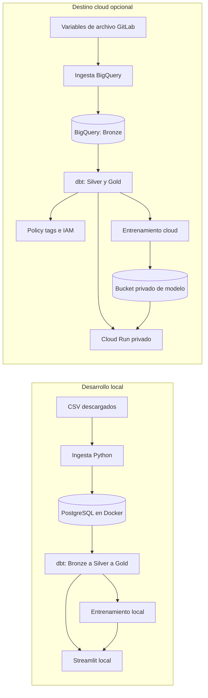
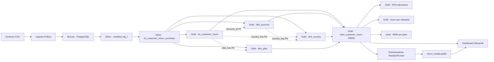

# RavenStack: SaaS Churn Intelligence

**Autor:** Camilo Chavol Sandoval  
**GitHub:** [@camilochavolsandoval](https://github.com/camilochavolsandoval)  
**Formación:** Ingeniero Civil Informático

**Tipo de proyecto:** proyecto personal de portafolio, creado como demostración integral de mis habilidades. El dataset es externo y se atribuye a Rivalytics; el diseño del pipeline, las transformaciones, el modelo y la aplicación corresponden a este proyecto.

**Portafolio 3 en 1:** ingeniería de datos, analítica de negocio y ciencia de datos, todo esto enfocado a la retención de clientes SaaS.

RavenStack ingiere datos operacionales desde CSV y los transforma con dbt siguiendo una arquitectura Medallón. PostgreSQL en Docker es el entorno local de desarrollo; el mismo proyecto dbt incluye BigQuery como destino cloud opcional. La plataforma publica métricas, entrena un clasificador de churn y ofrece un dashboard interactivo con un simulador de riesgo.

## Demo pública para el portafolio

El repositorio incluye una demo web estática en `docs/` para que un reclutador pueda revisar el proyecto desde GitHub Pages sin iniciar sesión, instalar dependencias, ejecutar Docker ni conectarse a una base de datos. La página `docs/index.html` contiene sus estilos y lógica; `docs/assets/demo_data.json` contiene únicamente resultados agregados del dataset sintético (KPIs y segmentos), sin identificadores de cuentas, nombres de empresas ni comentarios. Los gráficos y filtros se ejecutan en el navegador y no llaman a APIs, CDNs ni servicios cloud.

Esta vista pública es una instantánea analítica del proyecto. El dashboard completo de Streamlit, la ingesta, dbt y el entrenamiento siguen siendo el flujo reproducible de desarrollo local descrito abajo y sí requieren sus dependencias locales, PostgreSQL y los archivos fuente. La demo estática permite mostrar resultados y arquitectura; no ofrece inferencia interactiva del modelo ni sustituye la aplicación local.

Para regenerar el resumen después de ejecutar la ingesta y dbt localmente:

```powershell
python src/export_static_demo.py
```

Para previsualizarlo sin Docker en el equipo de desarrollo:

```powershell
python -m http.server 8000 --directory docs
```

Luego abre `http://localhost:8000`. La demo ya está publicada en [GitHub Pages](https://camilochavols.github.io/ingenieria-datos/). El despliegue automatizado está definido en `.github/workflows/deploy-pages.yml`: valida la página y el JSON, empaqueta `docs/` y lo publica cuando se suben cambios pertinentes a `main`. Para usar este workflow, en **Settings → Pages → Build and deployment → Source** se debe seleccionar **GitHub Actions**. Los procedimientos de publicación, diagnóstico y rollback están en [`docs/runbook_deployment.md`](docs/runbook_deployment.md). La demo pública no requiere que el reclutador inicie sesión.

> **Estado del modelo:** en la última ejecución local, el ROC-AUC holdout fue **0,4272** (100 cuentas: 78 sin churn y 22 con churn); el recall de churn fue **0,09**. Con los datos y variables actuales el modelo no demuestra capacidad predictiva fiable. Las predicciones son exploratorias: deben evaluarse según el contexto, la población y el período analizados, el objetivo de negocio y el costo relativo de falsos positivos y falsos negativos. El umbral 0,5 del simulador es inicial, no validado para una decisión de negocio.

## Qué resuelve

El proyecto integra el ciclo analítico completo para explorar preguntas como:

- ¿Cuántos clientes siguen activos y cuál es el MRR de sus suscripciones más recientes?
- ¿Cómo varía el churn por industria, país o plan?
- ¿Qué variables disponibles de una cuenta cambian su riesgo estimado de churn?
- ¿Cómo se conectan la ingesta, el modelado analítico y la entrega de resultados en una aplicación que puede explorar un equipo de negocio?

## Caso de negocio: qué se analiza y para qué

En un negocio SaaS, un cliente que cancela puede reducir el ingreso recurrente y aumentar el costo de adquisición necesario para reemplazarlo. RavenStack organiza datos de cuentas, suscripciones, uso del producto, soporte y cancelaciones para entender **quién está activo, cuánto MRR está asociado a clientes activos, dónde se concentra el churn y qué señales podrían ayudar a priorizar una revisión de retención**.

El objetivo de demostración es convertir archivos operacionales dispersos en información que se pueda consultar y discutir. El dashboard permite explorar segmentos; los marts Gold hacen reutilizables las métricas; y el clasificador muestra cómo se llevaría una estimación de riesgo a una interfaz. El proyecto no afirma que el modelo actual permita decidir qué clientes contactar: su validación es débil y el uso final depende de los objetivos, costos y contexto de la empresa.

### Secuencia de trabajo aplicada

1. **Traducir el problema a preguntas.** Se priorizan churn, retención y MRR activo porque conectan la cancelación de clientes con ingresos recurrentes y acciones de retención. En un proyecto real, se acordarían con negocio la definición de cliente activo, el horizonte de churn y el costo de cada tipo de error.
2. **Entender los datos antes de combinarlos.** Se identifican las claves y granularidad de cada archivo. Las cuentas son entidades; las suscripciones y eventos tienen historial. El dataset contiene 500 cuentas y 5.000 suscripciones, así que unir todo directamente duplicaría clientes y sesgaría KPIs.
3. **Conservar el origen.** Se cargan los CSV en Bronze para poder reconstruir transformaciones y distinguir los datos recibidos de las reglas analíticas.
4. **Preparar datos confiables.** Silver limpia identificadores y categorías, convierte tipos y filtra claves vacías. La fact elige la suscripción más reciente por cuenta y agrega uso y soporte antes de unirlos, manteniendo una fila por cliente.
5. **Definir métricas reutilizables.** Gold calcula clientes activos y churn, retención, MRR activo y cortes por industria y plan. Así el dashboard consume definiciones comunes en lugar de repetir joins sobre datos crudos.
6. **Explorar y comunicar.** Los filtros y gráficos muestran cómo cambian las métricas por segmento. Esto ayuda a formular hipótesis y localizar concentraciones; una asociación visual por sí sola no prueba la causa del churn.
7. **Evaluar antes de recomendar.** Se entrena un clasificador con una partición holdout y se revisan precision, recall y ROC-AUC. El resultado actual indica que hace falta mejorar datos y validación antes de convertir un score en una acción operativa.
8. **Cerrar el ciclo con negocio.** En una aplicación real, el equipo definiría qué casos revisar, qué acción ofrecer, qué resultado medir y cómo comparar la retención posterior con un grupo de referencia.

## Origen de los datos y extracción

La fuente es **SaaS Subscription & Churn Analytics Dataset**, publicado por **Rivalytics en Kaggle** ([página del dataset](https://www.kaggle.com/datasets/rivalytics/saas-subscription-and-churn-analytics-dataset)). Es un conjunto **sintético** que representa las operaciones de una empresa SaaS ficticia llamada RavenStack. Los CSV no llegan como una base analítica integrada: cada archivo describe una parte del negocio, usa su propia granularidad y debe relacionarse mediante claves.

| Archivo de origen | Qué representa | Grano principal |
| --- | --- | --- |
| `ravenstack_accounts.csv` | Perfil de cuenta: nombre, industria, país, plan y bandera de churn. | Una fila por cuenta (500). |
| `ravenstack_subscriptions.csv` | Ciclos de suscripción, plan, fechas, MRR/ARR, upgrades y renovaciones. | Una fila por suscripción (5.000); una cuenta puede tener historial. |
| `ravenstack_feature_usage.csv` | Actividad por funcionalidad, conteos, duración y errores. | Una fila por evento de uso. |
| `ravenstack_support_tickets.csv` | Solicitudes, prioridad, resolución y satisfacción. | Una fila por ticket. |
| `ravenstack_churn_events.csv` | Eventos de churn, fecha, motivo, reembolsos y reactivaciones. | Una fila por evento (600); una cuenta puede tener varios. |

### Qué hice con los datos en bruto

Partí de los cinco archivos CSV originales ubicados en `data/`. **La extracción y carga implementadas** están en `src/ingestion.py`: el script localiza los archivos, los lee con pandas, crea el esquema `bronze` si hace falta y carga cada CSV en su tabla PostgreSQL correspondiente. La conexión usa `.env` y las rutas se calculan desde la ubicación del script, no desde la carpeta actual de la terminal.

La ingesta es un **full refresh**: primero valida y lee los cinco archivos obligatorios y luego reemplaza las tablas Bronze dentro de una transacción PostgreSQL. Si falta un CSV o falla una lectura/carga, la ejecución falla y la transacción evita dejar una mezcla parcial de tablas nuevas y anteriores. Volver a ejecutar con los mismos archivos converge al mismo snapshot; no agrega duplicados. Conserva el contenido de origen sin aplicar reglas de negocio. El script no descarga datos de Kaggle: los CSV deben estar previamente disponibles en `data/`.

### Por qué la preparación era necesaria

Los archivos no forman por sí solos una tabla lista para analizar. Las cuentas tienen múltiples suscripciones históricas y puede haber varios eventos o tickets por cuenta. Unir esos archivos directamente multiplicaría filas, inflaría MRR y clientes, y sesgaría las métricas. Por eso primero se inspeccionan claves y granularidades, se preservan las fuentes en Bronze y luego se deduplica o agrega según la entidad antes de construir Silver y Gold.

## Arquitectura

### Pipelines y forma de ejecución

El proyecto implementa un pipeline de datos y un flujo posterior de entrenamiento e inferencia. Se ejecutan localmente y en orden mediante comandos; no hay un orquestador ni una programación automática:

1. `python src/ingestion.py`: carga completa de los CSV a PostgreSQL Bronze.
2. `dbt run --project-dir dbt_project`: transforma Bronze en modelos Silver y marts Gold.
3. `dbt test --project-dir dbt_project`: valida unicidad, claves no nulas y relaciones entre hecho y dimensiones.
4. `python src/ml/train_model.py`: consulta Gold, entrena y serializa el modelo.
5. `streamlit run src/app/app.py`: inicia el dashboard, que consulta Gold y carga el artefacto de ML para las inferencias.

Las tres primeras etapas se vuelven a ejecutar manualmente cuando se actualizan los datos o se desea reentrenar. Streamlit es la aplicación de consumo; no orquesta las etapas anteriores.

### Arquitectura recomendada: PostgreSQL local + BigQuery en la nube

La arquitectura usa dos entornos con propósitos distintos. **PostgreSQL local** permite desarrollar, cargar los CSV y validar el flujo con Docker Compose sin depender de una cuenta cloud. **BigQuery** es el destino analítico administrado previsto para la ejecución cloud, con los mismos conceptos Bronze, Silver y Gold mediante los targets de dbt. No existe replicación automática entre PostgreSQL y BigQuery: cada ejecución carga las fuentes en el destino seleccionado.

| Entorno | Flujo | Propósito |
| --- | --- | --- |
| Local | CSV → `src/ingestion.py` → PostgreSQL (`bronze`) → dbt (`silver`, `gold`) → Streamlit y entrenamiento | Desarrollo, exploración y ejecución de bajo costo en el equipo local. |
| Cloud, preparado | CSV entregados como variables de archivo de GitLab → `src/ingestion_bigquery.py` → BigQuery (`bronze`) → dbt (`silver`, `gold`) → gobernanza, entrenamiento y Cloud Run | Demostrar una ruta cloud con servicios administrados, controles de acceso y despliegue privado. Requiere aprovisionamiento y credenciales reales. |



La configuración cloud está preparada en código, pero no se ha ejecutado contra un proyecto Google Cloud: necesita proyecto y facturación, aplicar Terraform, configurar la federación OIDC entre GitLab y Google Cloud y registrar las variables protegidas. Por tanto, BigQuery, los policy tags, Vertex AI y Cloud Run describen el destino desplegable previsto, no recursos que ya estén activos.

### Tecnologías y lenguajes

| Tecnología o lenguaje | Uso en el proyecto |
| --- | --- |
| **Python** | Extracción/carga de CSV, preparación de datos, entrenamiento e inferencia del modelo, conexión a PostgreSQL y aplicación Streamlit. |
| **SQL** | Transformaciones dbt, limpieza, selección de la suscripción más reciente, agregaciones y marts analíticos. |
| **PostgreSQL en Docker** | Base relacional local; Docker Compose levanta el contenedor `ravenstack_postgres` y su volumen persistente. |
| **BigQuery** | Destino cloud alternativo; el mismo dbt modela Bronze, Silver y Gold mediante el target `cloud_bigquery`. |
| **dbt** | Dependencias entre modelos, vistas de preparación, tablas dimensionales y pruebas de claves/relaciones. |
| **YAML** | Configuración de Docker Compose, del proyecto dbt y de fuentes/documentación de modelos. |
| **PowerShell** | Comandos documentados para configurar y ejecutar el proyecto en Windows. |
| **Markdown** | Documentación del proyecto y del dataset. |



### Bronze: datos de origen

`src/ingestion.py` carga los cinco CSV de `data/` a PostgreSQL sin aplicar reglas analíticas. El esquema `bronze` conserva los datos crudos; dbt registra estas tablas como fuentes en `dbt_project/models/bronze/sources.yml`. Bronze es una fuente externa para dbt y se materializa con la ingesta, sin duplicar cada tabla en otro modelo SQL.

### Silver: limpieza y modelo relacional

Los modelos `stg_*` convierten los valores de origen en fechas, números, booleanos, cadenas normalizadas y claves depuradas. `silver.fct_customer_churn_summary` es la relación consolidada de Silver: selecciona la suscripción más reciente y agrega uso y tickets, antes del esquema dimensional de Gold. `gold.fct_customer_churn` es la tabla de hechos del modelo estrella y se une a las dimensiones Gold.

### Gold: métricas de negocio

Gold implementa un esquema estrella sencillo en el esquema `gold`. `dim_account` describe la cuenta; `dim_country` y `dim_plan` describen país y categoría de suscripción; `fct_customer_churn` contiene las claves de dimensión y las medidas. Las claves de cuenta, país y plan son claves naturales normalizadas, por lo que una carga idéntica produce las mismas claves y no necesita secuencias ni asignación aleatoria de IDs.

**Granularidad de `fct_customer_churn`: una fila por cuenta en el snapshot actual del dataset.** `account_id` es la clave única del hecho y la clave de unión con `dim_account`; `plan_key` apunta a `dim_plan`; `country_key` apunta a `dim_country`. `country_key` se conserva también en `dim_account` y en el hecho para soportar el filtrado por país en las tablas físicas de BigQuery. Las claves de dimensiones faltantes se representan con `Unknown`/`UNKNOWN`. El hecho incluye MRR, churn/actividad, uso y soporte. MRR, conteos de uso, errores y tickets son medidas sumables a este grano; promedios de satisfacción y resolución no deben sumarse y requieren agregación apropiada.

`dim_account`, `dim_country` y `dim_plan` describen los atributos que vienen en la fuente actual; se reconstruyen con cada full refresh. El snapshot sintético contiene códigos `AU`, `CA`, `DE`, `FR`, `IN`, `UK` y `US`; `US` es el país de demostración predeterminado para el filtro de filas en BigQuery. No son dimensiones históricas SCD tipo 2, y el proyecto no inventa una fecha de snapshot: el dataset no ofrece una fecha de extracción fiable. Así se evita afirmar análisis temporal que los datos no respaldan. `mart_customer_churn` mantiene una tabla ancha de presentación que une el hecho y las dimensiones para Streamlit y el entrenamiento.

Los modelos del esquema `gold` se materializan como tablas:

| Modelo | Granularidad y contenido |
| --- | --- |
| `dim_account` | Una fila por cuenta; nombre, industria y FK de país. |
| `dim_country` | Una fila por código de país, incluida la categoría `UNKNOWN`. |
| `dim_plan` | Una fila por plan; usa la categoría del plan como clave natural. |
| `fct_customer_churn` | Una fila por cuenta del snapshot; FKs a cuenta, plan y país, MRR, churn, uso y soporte. |
| `mart_customer_churn` | Tabla de presentación a nivel de cuenta, unida desde el hecho y sus dimensiones. Fuente de Streamlit y del entrenamiento. |
| `mart_executive_kpis` | Una fila con clientes totales, activos y churned, tasas de churn y retención, MRR activo y MRR activo promedio. |
| `mart_churn_by_industry` | Clientes, churn, actividad, tasa de churn y MRR activo por industria. |
| `mart_mrr_by_plan` | Clientes, MRR activo promedio y tasa de churn por plan. |

Los tests dbt comprueban que las claves de dimensiones y el grano del hecho sean únicos/no nulos, y que sus claves de cuenta y plan tengan correspondencia en las dimensiones. La macro `dbt_project/macros/generate_schema_name.sql` materializa los modelos en los esquemas físicos `silver` y `gold`, sin concatenar el esquema del perfil dbt con el nombre de la capa.

**Idempotencia y estrategia de carga:** la ingesta PostgreSQL exige todas las fuentes antes de escribir y reemplaza las cinco tablas Bronze dentro de una transacción. dbt reconstruye los modelos Silver (principalmente vistas; la relación consolidada se materializa como tabla) y las tablas Gold a partir de las fuentes actuales, sin añadir filas por cada ejecución. La ingesta BigQuery también usa `WRITE_TRUNCATE`, por lo que repetir una carga completa con los mismos CSV reemplaza el contenido de cada tabla en vez de duplicarlo; el proceso cloud no es una transacción multi-tabla, así que si falla a mitad de camino se debe volver a ejecutar la carga completa antes de continuar dbt.

## KPI definidos

Los KPI usan la cuenta como unidad de análisis. En el dashboard se recalculan para la selección de industria, país y plan; en Gold se publican en `mart_executive_kpis` y se desglosan por industria o plan en los marts correspondientes.

| KPI | Definición aplicada | Para qué sirve |
| --- | --- | --- |
| **Clientes totales** | Número de cuentas incluidas en el conjunto o filtro actual. | Establece la base del análisis. |
| **Clientes activos** | Número de cuentas cuyo `is_active` es 1 (`is_churned` es 0). | Dimensiona la cartera que permanece activa. |
| **Clientes con churn** | Número de cuentas cuyo `is_churned` es 1, según el `churn_flag` de la cuenta. | Cuantifica las cuentas marcadas como churn en el snapshot analizado. |
| **Tasa de churn (%)** | `clientes con churn / clientes totales × 100`. | Compara la proporción de cuentas churned entre segmentos. |
| **Tasa de retención (%)** | `clientes activos / clientes totales × 100`. | Mide la proporción de cuentas que permanecen activas; en este snapshot complementa la tasa de churn. |
| **MRR activo** | Suma del MRR de la suscripción más reciente de las cuentas activas. | Cuantifica el ingreso mensual recurrente asociado a la cartera activa. |
| **MRR activo promedio** | MRR activo dividido por el número de cuentas activas; Gold promedia el MRR de las cuentas activas. | Compara el ingreso recurrente promedio por cuenta activa. |

**Alcance:** churn y retención aquí son proporciones del estado registrado en los datos, no tasas de cancelación por mes o cohorte. Para análisis temporal se necesitarían fechas de observación, una ventana de medición y definiciones de elegibilidad acordadas con negocio.

## Dashboard y analítica

`src/app/app.py` usa Streamlit, Plotly, pandas y SQLAlchemy. Lee `gold.mart_customer_churn` y ofrece:

- Filtros combinables por industria, país y plan.
- KPIs recalculados para la selección: **MRR activo**, tasa de churn y clientes activos. MRR activo suma el ingreso mensual de las cuentas activas.
- Gráfico de tasa de churn por industria y distribución de MRR por plan.
- Tabla de las cuentas filtradas.
- Simulador que acepta plan, MRR, uso de funcionalidades, errores, tickets, tiempo promedio de resolución y satisfacción. Entrega una probabilidad y acciones sugeridas de retención.

Los datos se guardan en caché durante cinco minutos y la barra lateral permite actualizar la consulta. Si falla la conexión, la tabla está vacía o falta el modelo, la interfaz muestra un diagnóstico.

### Interpretación del riesgo

El RandomForest convierte su probabilidad en una categoría usando inicialmente el umbral 0,5. Ese umbral no incorpora el costo de intervenir a un cliente que no iba a cancelar ni el de dejar pasar una cancelación real. Antes de usarlo para decidir, hay que definir el objetivo —por ejemplo, detectar más casos o reducir falsas alarmas— y evaluar precisión, recall, calibración y costos para la población y período pertinentes. La advertencia del dashboard comunica la baja señal observada en la validación actual.

## Ciencia de datos y evaluación

`src/ml/train_model.py` lee Gold, prepara seis variables numéricas y codifica `plan_tier` con one-hot encoding. Imputa faltantes numéricos con la mediana, divide entrenamiento y prueba de forma estratificada y entrena un `RandomForestClassifier` con 300 árboles, ponderación de clases, tamaño mínimo de hoja 5 y semilla fija. Reporta precision, recall, F1, accuracy y ROC-AUC. Guarda `models_saved/churn_model.joblib` junto con el ROC-AUC holdout para que Streamlit pueda mostrar la advertencia.

La ejecución de referencia obtuvo:

| Métrica holdout | Resultado |
| --- | ---: |
| Accuracy | 0,52 |
| Precision de churn | 0,07 |
| Recall de churn | 0,09 |
| ROC-AUC | 0,4272 |

El dataset incluido contiene 500 cuentas, 5.000 registros de suscripciones y 600 eventos de churn. La validación de referencia usa una sola partición estratificada de 100 cuentas; es reproducible, pero no demuestra rendimiento en producción. Un ROC-AUC cercano a 0,5 sugiere que las variables disponibles pueden no contener señal suficiente. Para mejorar el resultado hay que revisar calidad y temporalidad de etiquetas, incorporar variables conocidas antes del churn, evaluar por período y acordar con negocio las métricas y costos objetivo. Las probabilidades actuales no deben presentarse como fiables.

## Enriquecimiento con IA generativa

El enriquecimiento opcional con Gemini clasifica comentarios de eventos de churn en tema, sentimiento, resumen, evidencia y confianza mediante un esquema validado. Registra version de prompt/modelo, reutiliza resultados existentes, limita registros, caracteres y tokens de salida, y solo llama al modelo con --execute. Antes del envio se enmascaran patrones comunes de correo, telefono y URL; esto no detecta toda la informacion personal ni sustituye una revision humana. El trabajo CI es manual y requiere Vertex AI habilitado, permisos y limites de consumo. El dataset es sintetico; los resultados deben revisarse segun calidad y contexto, y esta plantilla no certifica cumplimiento GDPR/LGPD.

El flujo envía únicamente el texto del comentario —no cuenta ni identificadores— y solicita una salida estructurada con tema, sentimiento, resumen, evidencia textual y confianza. La respuesta se valida con un esquema Pydantic y se guarda en `silver.churn_feedback_enrichment` junto con modelo, versión del prompt y fecha de procesamiento. El resultado es una etiqueta derivada para análisis; no reemplaza `is_churned` ni se considera verdad de terreno.

**Control de ejecución y costo:** el comando funciona en modo dry-run por defecto; llamar a Gemini requiere `--execute`. `AI_MAX_RECORDS` limita las llamadas por ejecución, `AI_MAX_CHARS` limita el texto enviado y cada respuesta tiene un máximo de tokens. Solo procesa eventos todavía no enriquecidos para esa versión del prompt; `--force` permite volver a procesarlos explícitamente. Las llamadas son secuenciales y no se hace ninguna llamada desde dbt o al abrir el dashboard.

Para revisar candidatos sin consumir llamadas y luego ejecutar una muestra pequeña:

```powershell
python src/ai/enrich_feedback.py --limit 5
python src/ai/enrich_feedback.py --execute --limit 5
```

La ejecución requiere `GCP_PROJECT_ID`, `GCP_LOCATION` y `GEMINI_MODEL` en `.env`, una identidad de Google Cloud autenticada mediante Application Default Credentials y Vertex AI habilitado. El dataset actual es sintético; con texto real habría que evaluar privacidad, finalidad y condiciones de tratamiento antes de enviar datos a un proveedor. El enriquecimiento debe evaluarse con una muestra etiquetada manualmente y no se considera una mejora predictiva hasta que una validación apropiada lo demuestre.

## Habilidades demostradas

### Ingeniería de datos

1. **Inspeccionar fuentes y granularidad:** reconocer que las cuentas tienen varias suscripciones y que tickets/eventos también son históricos.
2. **Ingerir sin mezclar reglas de negocio:** cargar CSV con Python y pandas a PostgreSQL Bronze y aislar credenciales en `.env`.
3. **Transformar por capas:** registrar fuentes en dbt; limpiar y tipar en Silver; materializar modelos de consumo en Gold.
4. **Modelar dimensiones y hechos:** definir `dim_account`, `dim_country`, `dim_plan` y `fct_customer_churn`, con claves naturales y tests de unicidad, nulidad y relaciones. El grano explícito del hecho es una fila por cuenta del snapshot actual; antes de construirlo se selecciona una suscripción por cuenta y se agregan uso/tickets para evitar fan-out.
5. **Hacer repetible la carga:** exigir los cinco CSV, validarlos antes de modificar PostgreSQL y reemplazar Bronze dentro de una transacción; reconstruir dimensiones, hechos y marts desde el snapshot sin duplicar filas al reejecutar.
6. **Hacer reproducible el entorno:** levantar PostgreSQL con Docker Compose, parametrizar los esquemas dbt y ejecutar el pipeline con `dbt run`.

**Valor que demuestra:** capacidad de diseñar y operar el flujo desde archivos de origen hasta tablas analíticas con responsabilidades y granularidades explícitas.

### Analítica de datos

1. **Definir la medida:** MRR activo es el MRR de cuentas activas; tasa de churn es cuentas con churn dividido por las cuentas de la selección; retención es la proporción activa.
2. **Preparar el consumo:** publicar totales ejecutivos y desgloses por industria y plan en Gold.
3. **Permitir exploración:** mostrar KPIs, distribución de MRR, churn por industria y registros filtrados en Streamlit/Plotly.
4. **Comunicar límites:** distinguir una diferencia entre segmentos de una causa y explicar que el score actual aún no soporta decisiones operativas.

**Valor que demuestra:** capacidad de pasar de una necesidad de negocio a definiciones de métricas, análisis segmentado y una interfaz comprensible para usuarios.

### Ciencia de datos

1. **Definir target y variables:** `is_churned` proviene del `churn_flag` de la cuenta; se utilizan MRR, plan, uso de funciones, errores, tickets, tiempo de resolución y satisfacción.
2. **Preparar el conjunto:** imputar faltantes numéricos con la mediana, codificar plan y separar entrenamiento/prueba de forma estratificada.
3. **Entrenar y persistir:** ajustar un RandomForest con ponderación de clases y guardar el artefacto para inferencia desde Streamlit.
4. **Evaluar el caso de uso:** leer métricas por clase y ROC-AUC; la última ejecución local (ROC-AUC 0,4272, recall churn 0,09) muestra que las variables disponibles no dan una señal fiable.
5. **Conectar con una decisión responsable:** escoger un umbral solo después de definir si el negocio prioriza detectar más casos o reducir falsas alarmas, considerando el costo de cada error.

**Valor que demuestra:** conocimiento del flujo supervisado completo y criterio para no confundir que un modelo produzca probabilidades con que sea útil para el negocio.

### Desarrollo de software

- Separar responsabilidades en ingesta, entrenamiento y aplicación; resolver rutas desde la ubicación de los scripts.
- Aislar credenciales en `.env`, mantener `.env.example` y excluir secretos, entornos virtuales, cachés y artefactos locales con `.gitignore`.
- Manejar errores de conexión, tablas vacías y falta del modelo con mensajes visibles para el usuario.

### Cloud, CI/CD y gobernanza

- Preparar una ruta GitLab CI/CD con validaciones de Python/dbt y Terraform, más trabajos manuales para BigQuery, enriquecimiento generativo y Cloud Run.
- Diseñar autenticación GitLab–Google Cloud mediante OIDC/Workload Identity Federation y cuentas de servicio separadas por responsabilidad, evitando llaves permanentes en el repositorio.
- Declarar con Terraform datasets BigQuery, bucket privado del modelo, Artifact Registry, IAM, taxonomía y policy tag; aplicar controles de columna y acceso por filas después de materializar los datos.
- Preparar publicación manual desde la rama principal de GitLab al repositorio público `camilochavolsandoval/ingenieria-datos`; el job comprueba la cuenta, crea el repositorio público si no existe y luego publica sin forzar el historial.

Estas piezas son plantillas preparadas y revisables. No demuestran todavía un pipeline cloud ejecutado, recursos desplegados ni publicación completada; eso requiere las cuentas, permisos, variables protegidas y ejecuciones indicadas en la sección de configuración.

## Estructura del repositorio

```text
.
├── data/                       # CSV de origen y descripción del dataset
├── database/
│   └── docker-compose.yml      # PostgreSQL local
├── dbt_project/
│   ├── macros/                 # Resolución de esquemas Medallón
│   └── models/
│       ├── bronze/             # Fuentes crudas PostgreSQL
│       ├── silver/             # Staging y fact relacional
│       └── gold/               # Dimensiones, hecho estrella y marts de negocio
├── terraform/                  # Plantilla de infraestructura e IAM en Google Cloud
├── .gitlab/
│   └── ci/                     # Autenticación OIDC y trabajos CI/CD auxiliares
├── models_saved/               # Artefacto local del clasificador (ignorado por Git)
├── src/
│   ├── ingestion.py            # CSV → PostgreSQL Bronze
│   ├── ingestion_bigquery.py   # CSV → BigQuery Bronze
│   ├── governance/             # Policy tags y acceso por filas en BigQuery
│   ├── ai/                     # Enriquecimiento opcional con Gemini
│   ├── ml/                     # Entrenamiento, evaluación y carga privada del modelo
│   └── app/app.py              # Dashboard e inferencia local/cloud
├── .env.example                # Plantilla de configuración
├── .gitlab-ci.yml              # Validación y ejecución manual de flujos
├── .gitignore
├── requirements.txt
└── README.md
```

## Requisitos y puesta en marcha

Se requiere Python 3.10 o posterior, Docker Desktop con Compose y acceso a PostgreSQL. Desde PowerShell, en la raíz del repositorio:

```powershell
python -m venv .venv
.\.venv\Scripts\Activate.ps1
pip install -r requirements.txt
if (-not (Test-Path .env)) { Copy-Item .env.example .env }
```

Descarga el dataset desde Kaggle y deja en `data/` estos cinco archivos con sus nombres originales: `ravenstack_accounts.csv`, `ravenstack_subscriptions.csv`, `ravenstack_feature_usage.csv`, `ravenstack_support_tickets.csv` y `ravenstack_churn_events.csv`. No se incluyen en Git porque son archivos de datos de origen ignorados por `.gitignore`; el script de ingesta no los descarga automáticamente.

Configura `DB_HOST`, `DB_PORT`, `DB_NAME`, `DB_USER` y `DB_PASSWORD` en `.env`. Docker Compose y los scripts Python leen ese archivo. El perfil dbt `%USERPROFILE%\.dbt\profiles.yml` debe usar las mismas credenciales con `env_var()`. Para exponer las variables de `.env` a dbt en la sesión actual de PowerShell:

```powershell
Get-Content .env | ForEach-Object {
    if ($_ -match '^\s*([^#=]+)=(.*)$') {
        $name = $matches[1].Trim()
        $value = $matches[2].Trim()
        [Environment]::SetEnvironmentVariable($name, $value, 'Process')
    }
}
```

En una base nueva, `.env.example` contiene credenciales locales de demostración. Si el volumen PostgreSQL ya existe, usa la contraseña con que se inicializó ese volumen: cambiar `DB_PASSWORD` no cambia la contraseña almacenada dentro de una base existente.

Ejecuta el pipeline y la aplicación:

```powershell
docker compose -f database/docker-compose.yml up -d
python src/ingestion.py
dbt run --project-dir dbt_project
dbt test --project-dir dbt_project
python src/ml/train_model.py
streamlit run src/app/app.py
```

Streamlit indicará la URL local de la aplicación. Después de entrenar un modelo nuevo, reinicia Streamlit para cargar el artefacto actualizado.

## Variables de configuración

| Variable | Uso | Valor local de ejemplo |
| --- | --- | --- |
| `DB_DRIVER` | Driver SQLAlchemy | `postgresql+psycopg2` |
| `DB_HOST` | Host PostgreSQL | `localhost` |
| `DB_PORT` | Puerto publicado | `5432` |
| `DB_NAME` | Base de datos | `ravenstack_db` |
| `DB_USER` | Usuario PostgreSQL | `postgres` |
| `DB_PASSWORD` | Contraseña local | Definida en `.env` |

`.env` y el artefacto `.joblib` son locales y no deben subirse al repositorio.

## Alcance y mejoras futuras

El proyecto demuestra un pipeline local de extremo a extremo y una integración analítica reproducible. El flujo local aun no ha sido desplegado en cloud ni automatizado con una ejecucion programada. Las plantillas descritas arriba requieren configuracion y aprovisionamiento. Antes de usar el score para contactar clientes, se debe mejorar la señal del dataset, validar con datos temporales y definir con negocio el umbral y los costos aceptables.

## Agradecimientos

Gracias a **Rivalytics** por crear y publicar en Kaggle el dataset sintético *SaaS Subscription & Churn Analytics Dataset*, que hizo posible desarrollar este caso de estudio de ingeniería, analítica y ciencia de datos. [Consultar el dataset original en Kaggle](https://www.kaggle.com/datasets/rivalytics/saas-subscription-and-churn-analytics-dataset).

> **Estado del portafolio:** el flujo local PostgreSQL/dbt/Streamlit es el entorno base. Este repositorio incorpora además plantillas opcionales para BigQuery, Vertex AI, IAM y GitLab CI/CD; para activarlas se requiere un proyecto GCP, aprovisionar recursos y configurar variables protegidas en GitLab. El código no crea recursos de nube por sí solo y ninguna publicación o despliegue externo se ha realizado desde este entorno.

## CI/CD, nube y gobernanza opcionales

El proyecto incluye una plantilla GitLab CI/CD que valida Python, parsea dbt para PostgreSQL y BigQuery, y ejecuta `terraform init -backend=false` y `terraform validate` en cada rama. El trabajo manual de BigQuery exige cinco variables CI/CD de tipo **File**: `SOURCE_ACCOUNTS_CSV`, `SOURCE_SUBSCRIPTIONS_CSV`, `SOURCE_FEATURE_USAGE_CSV`, `SOURCE_SUPPORT_TICKETS_CSV` y `SOURCE_CHURN_EVENTS_CSV`. Cada variable debe contener el CSV correspondiente descargado de Kaggle; el job los copia temporalmente a `data/` y los carga a Bronze. Esto permite mantener los CSV fuera del repositorio público.

Los trabajos de carga a BigQuery, entrenamiento, enriquecimiento Gemini y despliegue a Cloud Run requieren activación explícita. GitLab se autentica a Google Cloud mediante OIDC/Workload Identity Federation, restringida al proyecto y rama protegida configurados; no se almacena una llave de cuenta de servicio. La configuración de Cloud Run consulta BigQuery, carga el modelo versionado desde un bucket privado y desactiva el acceso no autenticado. La app aún no está desplegada.

La carpeta `terraform/` declara datasets Bronze/Silver/Gold, IAM por identidad, bucket privado de modelos, Artifact Registry, APIs requeridas, taxonomía/policy tag y federación GitLab. Tras materializar Gold, `src/governance/apply_bigquery_governance.py` aplica tags a los identificadores de cuenta en `dim_account`, `fct_customer_churn` y `mart_customer_churn`. Aplica políticas de filas por país a las tablas físicas de cuenta, hecho y mart; la cuenta del pipeline recibe acceso completo para operar y permiso de lectura de columnas identificadoras para ejecutar joins/test dbt; analistas y runtime quedan filtrados por país y no reciben lectura de esas columnas por defecto. La app omite `account_id` y `account_name` en sus consultas. La configuración es una plantilla: requiere completar proyecto, región, grupo analítico, cuentas de servicio y ruta real del repositorio GitLab. Revísala con `terraform plan`; el despliegue puede generar costos.

La ejecucion cloud reutiliza el mismo flujo de enriquecimiento descrito en la seccion correspondiente, con Vertex AI habilitado y variables protegidas de GitLab.

El inventario, la clasificacion, el mapa de identidades y las obligaciones previas a produccion se documentan en [docs/data_governance.md](docs/data_governance.md).

El trabajo manual `publish_public_github` publica la rama principal de GitLab en `https://github.com/camilochavolsandoval/ingenieria-datos`. Antes del primer push, comprueba que `GITHUB_MIRROR_TOKEN` pertenece a esa cuenta y crea el repositorio como publico si aun no existe; no inicializa commits ni fuerza ni borra ramas. En GitLab configura `GITHUB_MIRROR_TOKEN` como variable protegida y enmascarada con alcance para crear repositorios publicos y escribir contenido (`public_repo` en un token clasico), y `PUBLISH_GITHUB=true`. `GITHUB_REPOSITORY_URL` es opcional y, si se define, debe coincidir con el destino anterior. El primer push requiere una rama principal disponible en GitLab; futuras sincronizaciones requieren que GitHub no tenga commits divergentes y que sus reglas de proteccion permitan el push del token.

Para habilitar los trabajos de nube, crea un proyecto GCP con facturación y aplica la infraestructura revisada en `terraform/`. Configura en GitLab las variables `GCP_PROJECT_ID`, `GCP_PROJECT_NUMBER`, `GCP_REGION`, `BQ_LOCATION`, `GCP_WIF_POOL`, `GCP_WIF_PROVIDER`, `GCP_PIPELINE_SERVICE_ACCOUNT`, `GCP_DEPLOY_SERVICE_ACCOUNT`, `CLOUD_RUN_RUNTIME_SERVICE_ACCOUNT`, `MODEL_BUCKET`, `AR_REPOSITORY`, `CLOUD_RUN_SERVICE`, `GOVERNANCE_GROUP`, `GOVERNANCE_COUNTRY`, `BQ_ACCOUNT_ID_POLICY_TAG`, `AI_MAX_RECORDS`, `ENABLE_GENAI_DASHBOARD`, `RUN_CLOUD_PIPELINE`, `RUN_GENAI` y `DEPLOY_CLOUD_RUN`. Los trabajos usan `GCP_PIPELINE_SERVICE_ACCOUNT` para ingesta, dbt, Gemini y entrenamiento; `GCP_DEPLOY_SERVICE_ACCOUNT` se reserva para Cloud Run y Cloud Build. Los outputs de Terraform proporcionan project number, pool, provider, policy tag y bucket. Para Gemini, define `GCP_LOCATION` y `GEMINI_MODEL`. Para la publicación, configura `GITHUB_MIRROR_TOKEN` protegido/enmascarado con los permisos indicados arriba y `PUBLISH_GITHUB=true`; el job crea el repositorio público si no existe. `GITHUB_REPOSITORY_URL` es opcional y debe apuntar al destino acordado. Define `gitlab_project_path` y `gitlab_protected_ref` con los valores reales. No subas `.env`, `terraform.tfvars`, estado de Terraform ni credenciales al repositorio.
